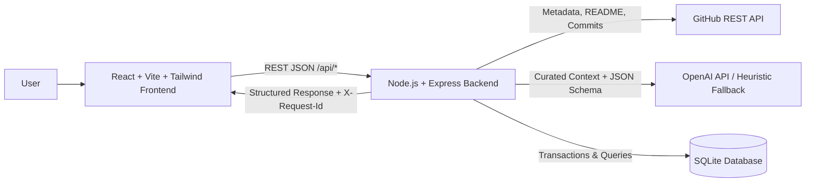
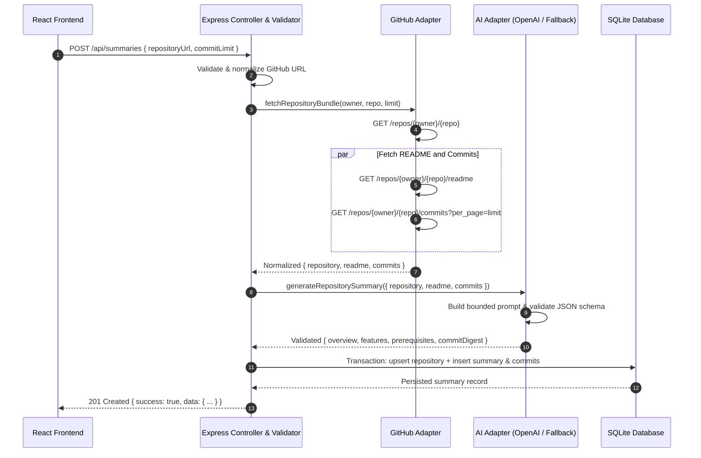
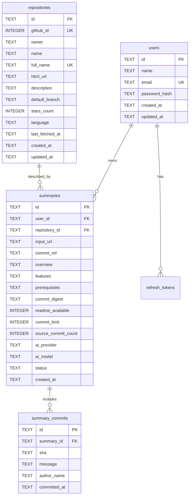

# System Architecture

## 1. High-Level Architecture



---

## 2. Layer Responsibilities & Boundaries

### Frontend (`client/`)
- Collects the GitHub repository URL and performs instant convenience validation.
- Communicates exclusively with the Express REST API (`VITE_API_BASE_URL`).
- Renders idle, loading, structured result, empty, and error states mapped to stable backend error codes.
- Displays summary history, summary details, and optional authentication views.
- Never calls the LLM provider directly or stores backend secrets.

### Express Backend (`server/` — ES Modules)
- Validates and normalizes all inputs on the server (regardless of client validation).
- Enforces security headers, CORS origin restrictions, payload limits (`1mb`), and IP-based rate limiting.
- Orchestrates calls across the GitHub adapter, AI adapter, and SQLite repository layer.
- Attaches a correlation `requestId` (`X-Request-Id`) to every request and response.
- Returns stable JSON contracts and standardized error envelopes without leaking stack traces.

### GitHub Adapter (`server/src/services/github/`)
- Strictly parses and normalizes GitHub URLs (`urlParser.js`), rejecting non-HTTPS schemes, non-`github.com` hosts, credentials, query strings, and path traversal attempts to prevent SSRF.
- Calls GitHub REST API v2022-11-28 (`githubClient.js`) with bounded timeouts (`10s`) and optional server-side `GITHUB_TOKEN`.
- Normalizes repository metadata, safely decodes and truncates Base64 README content (`MAX_README_CHARS`), and normalizes recent commits (`DEFAULT_COMMIT_LIMIT = 20`, capped at `50`).
- Gracefully handles missing READMEs (`404`) and empty repositories (`409`) without failing the summary pipeline.

### AI Adapter (`server/src/services/ai/`)
- Constructs structured system and user prompts (`promptBuilder.js`) that explicitly isolate repository metadata, README text, and commit messages as untrusted data to mitigate prompt injection.
- Calls OpenAI Chat Completions (`gpt-4o-mini` by default) with `response_format: { type: "json_object" }`.
- Includes an automatic **Heuristic Fallback Analyzer** (`buildHeuristicFallbackSummary` in `aiAdapter.js`) when `OPENAI_API_KEY` is not set or `AI_PROVIDER=mock`, extracting real features, prerequisites, and commit digests from the fetched GitHub data so frontend and backend contributors can develop and test offline or without paid API keys.
- Strictly validates output against the `{ overview, features, prerequisites, commitDigest }` schema (`outputValidator.js`) before persistence.

### Database & Data Access (`server/src/config/db.js` & `server/src/repositories/`)
- Uses Node.js built-in SQLite (`node:sqlite` `DatabaseSync`) with `PRAGMA foreign_keys = ON`.
- Runs idempotent DDL migrations automatically on server startup.
- Wraps multi-table writes (`repositories` upsert + `summaries` insert + `summary_commits` insert) inside atomic database transactions (`withTransaction`).

---

## 3. End-to-End Request Sequence



---

## 4. Backend Directory & Dependency Structure

```text
server/
├── src/
│   ├── config/
│   │   ├── env.js               # Environment variables & defaults
│   │   └── db.js                # SQLite connection, schema DDL & transactions
│   ├── controllers/
│   │   ├── healthController.js  # GET /api/health
│   │   ├── summaryController.js # Summary generation, history, detail & delete
│   │   └── authController.js    # Register, login, logout & current user
│   ├── middleware/
│   │   ├── requestContext.js    # X-Request-Id correlation & safe request logging
│   │   ├── security.js          # Security headers & sliding-window rate limiter
│   │   ├── auth.js              # optionalAuth & requireAuth JWT verification
│   │   └── errorHandler.js      # 404 & central error envelope formatter
│   ├── repositories/
│   │   ├── userRepository.js    # users table queries
│   │   ├── repoRepository.js    # repositories table upsert
│   │   └── summaryRepository.js # summaries & summary_commits persistence/pagination
│   ├── routes/
│   │   ├── index.js             # Mounts /health, /summaries, /auth under /api
│   │   ├── healthRoutes.js
│   │   ├── summaryRoutes.js
│   │   └── authRoutes.js
│   ├── services/
│   │   ├── github/
│   │   │   ├── urlParser.js     # Canonical GitHub URL parser & normalizer
│   │   │   └── githubClient.js  # GitHub REST API client & normalizers
│   │   ├── ai/
│   │   │   ├── promptBuilder.js # Prompt templates with untrusted-input guards
│   │   │   ├── outputValidator.js # Structured JSON output schema validator
│   │   │   └── aiAdapter.js     # OpenAI client + heuristic fallback generator
│   │   ├── summaryService.js    # Orchestrates GitHub -> AI -> DB workflow
│   │   └── authService.js       # scrypt password hashing & HS256 JWT tokens
│   ├── utils/
│   │   └── AppError.js          # Application error class (statusCode + stable code)
│   ├── validators/
│   │   ├── summaryValidator.js  # Request body, query & param validation
│   │   └── authValidator.js     # Registration & login input validation
│   └── app.js                   # Express app wiring & server entry point
└── tests/
    └── backend.test.js          # Unit & integration test suite (node:test)
```

---

## 5. Database Schema Overview



---

## 6. Recorded Architecture Decisions (ADRs)

1. **Module System:** ES Modules (`"type": "module"`) across the backend for modern JavaScript consistency with the Vite + React frontend.
2. **Database Engine:** Built-in SQLite (`node:sqlite`) storing data in `server/data/gitsummarizer.sqlite` (and `:memory:` during automated tests) so every collaborator can run the full stack immediately with zero external database server installation or native compilation issues.
3. **AI Provider Strategy:** OpenAI (`gpt-4o-mini`) via native `fetch` with strict JSON schema validation, paired with an automatic heuristic fallback mode when `OPENAI_API_KEY` is omitted so frontend development is never blocked by API key availability.
4. **Authentication & Ownership Strategy:** Optional JWT authentication (`optionalAuth` middleware). Anonymous users can generate, view, and delete anonymous summaries (`user_id IS NULL`), while authenticated users (`Authorization: Bearer <token>`) get isolated, user-scoped history (`user_id = <uuid>`).
